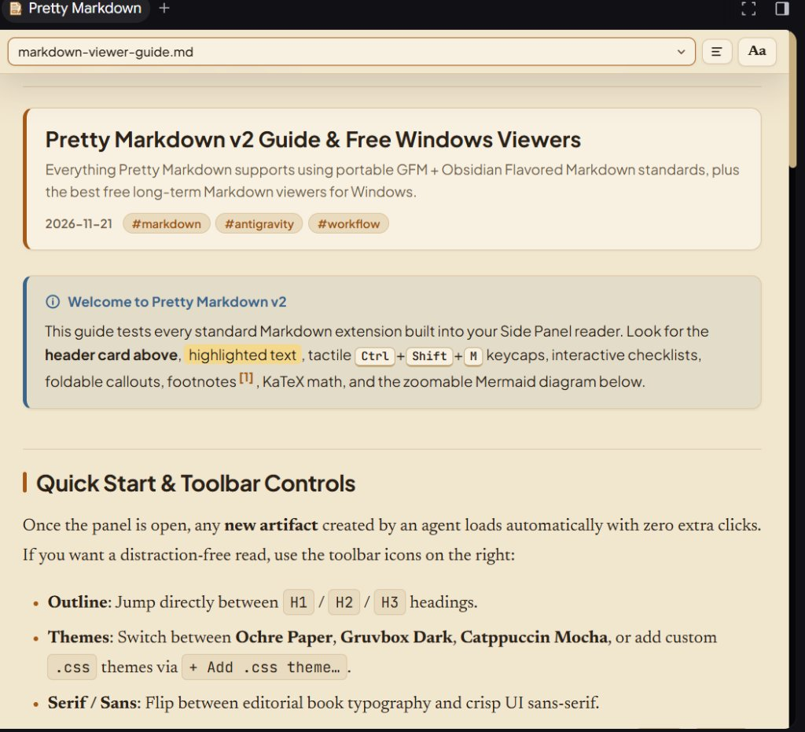
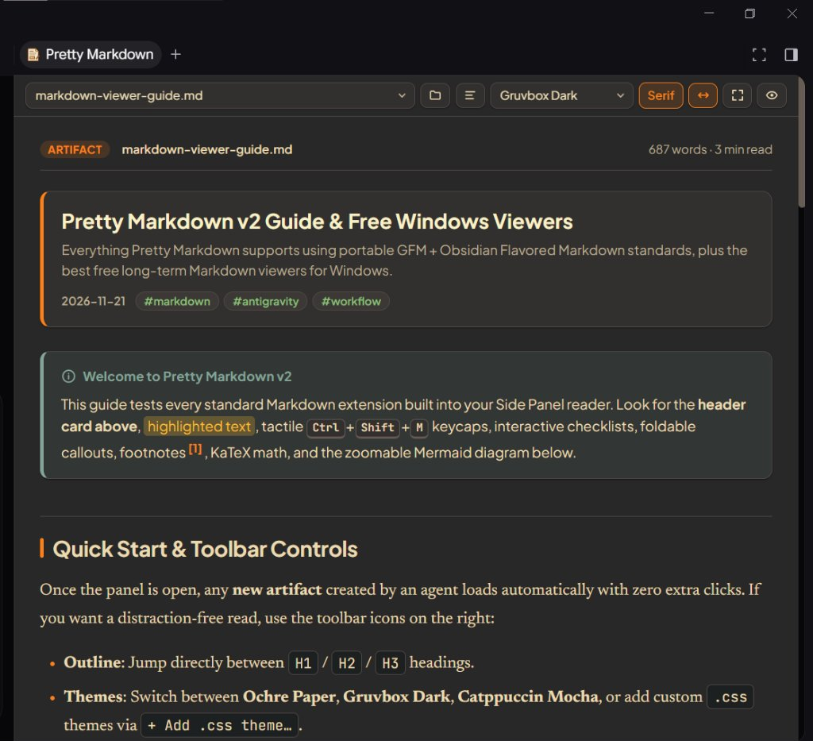

# antigravity-pretty-md

An editorial Markdown reader, cross-conversation document library, and study-note viewer for **Google Antigravity's Side Panel**, built on portable open standards (**GFM + Obsidian Flavored Markdown + KaTeX + Mermaid + Vega-Lite**).

> *Note: This plugin was vibe-coded with Gemini Neon.*

| Ochre Paper (Default Light) | Gruvbox Dark (Built-in Dark) |
| :---: | :---: |
|  |  |

## Why this exists

Antigravity's default Markdown artifact view works for quick checks, but reading long explanations, math proofs, or architecture notes in it gets cramped fast. `antigravity-pretty-md` replaces that friction with a distraction-free Side Panel reader that auto-loads new conversation artifacts, renders portable Markdown extensions 100% locally with zero cloud calls, and keeps every note readable in Obsidian, VS Code, or GitHub.

> **Important note on `rules/AGENTS.md`:** This isn't just a passive prettifier — the bundled [`rules/AGENTS.md`](rules/AGENTS.md) tells Antigravity to surface the 1-click reader pill and actually use the richer Markdown features (frontmatter, callouts, Vega-Lite plots, wikilinks, etc.). Edit it freely to match how you want your agents to write.

## What it does

- **Minimal Hover Top Bar (`[ File ▾ ] [ ≡ ] [ ⚙ ]`)**: Auto-hides while reading (optional pin toggle). Themes, typography (`Serif` / `Sans`, `A−` / `100%` / `A+`), width, and tools live neatly inside Settings sub-menus.
- **Light & Dark Themes + Custom CSS**: Defaults to **Ochre Paper** (high contrast against dark IDEs) and ships with **Gruvbox Dark** and **Catppuccin Mocha**. Drop any `.css` file into `themes/` (or use `+ Add .css`) to add your own.
- **All-Docs Library (`Ctrl+K`) & In-Doc Find (`Ctrl+F`)**: Search across all Antigravity conversation artifacts and open workspace `.md` files by title, summary, or YAML frontmatter tags.
- **Cross-Markdown Linking & History**: Click relative links (`./other.md`), Obsidian wikilinks (`[[note#Heading|Label]]`), `file:///` links, or `#heading` anchors inside the reader. Use `Alt+←` / `Alt+→` (or mouse Back/Forward) to jump back with exact scroll restoration.
- **Technical & Math Standards**: YAML frontmatter cards, collapsible `##` chapters with reading progress & Outline scrollspy, click-to-copy KaTeX math, `> [!THEOREM]` / `> [!LEMMA]` / `> [!PROOF]-` callouts, local interactive checklists, ````diff` line gutters, zoomable Mermaid diagrams, and interactive ````vega-lite` plots.
- **Opt-In Study Widgets**: Session-based **Flashcards** (`> [!FLASHCARDS]` with `- Front :: Back` bullets, or fenced ````flashcards` blocks) and **Quizzes** (fenced ````quiz` blocks with single/multi-choice + explanations) for test prep.
- **Quick Source Edit & Export**: Toggle raw edit mode (`Ctrl+S` to save back to disk), print/export clean PDF, copy clean Markdown, or 1-click save copies into a configured archive folder.

## Built to Be Customized

Everything is plain vanilla HTML/CSS/JS plus a single Node file (`main.mjs`) — **no build step, no bundler, no framework**. Edit any file, reload the panel, and your change is live. Swap themes in `themes/`, tweak agent behavior in `rules/AGENTS.md`, or hack `app.js` / `styles.css` directly.

## Repository Structure

- `plugin.json`: Antigravity plugin manifest (`pretty-md`).
- `rules/AGENTS.md`: Always-on agent rule documenting the 1-click `[Pretty Markdown](sidecar://pretty-md/md_reader/)` pill and supported Markdown extensions.
- `sidecars/md_reader/main.mjs`: Local Node sidecar server (`sidecar_sdk`, Node `>= 20`) serving the UI, local vendor bundles, file/library indexing, link resolution, and safe read/write/archive endpoints.
- `sidecars/md_reader/index.html`, `styles.css`, `app.js`: Self-contained frontend renderer (DOMPurify-sanitized, strict CSP, zero external CDN requests).
- `themes/_template.css.example`: Full starter template with every `--pm-*` CSS variable for custom themes.

## Setup & Installation

### 1. Clone into your Antigravity plugins folder

**macOS / Linux:**
```bash
git clone https://github.com/zeili0000/antigravity-pretty-md.git ~/.gemini/config/plugins/pretty-md
cd ~/.gemini/config/plugins/pretty-md/sidecars/md_reader
npm install
```

**Windows (PowerShell):**
```powershell
git clone https://github.com/zeili0000/antigravity-pretty-md.git "$env:USERPROFILE\.gemini\config\plugins\pretty-md"
cd "$env:USERPROFILE\.gemini\config\plugins\pretty-md\sidecars\md_reader"
npm.cmd install
```

### 2. Enable in Antigravity

Open **Plugins Manager** in Antigravity, enable **Pretty Markdown**, and open it from the side panel (or click any `[Pretty Markdown](sidecar://pretty-md/md_reader/)` pill in chat).

## Shortcuts

| Shortcut | Action |
| :--- | :--- |
| `Ctrl+K` / `Cmd+K` | Open All-Docs Library |
| `Ctrl+F` / `Cmd+F` | Find in current document |
| `Alt+←` / `Alt+→` | Navigate Back / Forward across links |
| `Ctrl+S` / `Cmd+S` | Save file in Raw / Edit mode |
| `?` | Toggle compact Power-User Reference |
| `Esc` | Close modal, popover, or find bar |

## License

MIT
